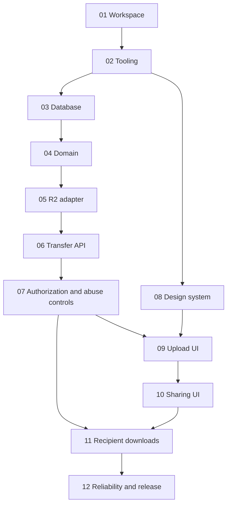

# DropIt — implementation roadmap

## Fixed MVP
Anonymous multi-file transfers; 10 files maximum, 100 MiB/file, 500 MiB/transfer (confirm whether published MB limits mean decimal MB or MiB before coding); default expiry 24 hours, maximum 7 days; unlimited downloads until expiry; optional transfer password; share link + QR; individual download and download-all ZIP. Next.js, Tailwind, NestJS/Fastify, PostgreSQL/Drizzle, Cloudflare R2, REST/JSON.

## Slice dependency graph

| Slice | Outcome | Gate |
|---|---|---|
| 01 | Bootable monorepo | web/API start independently |
| 02 | Reproducible checks | lint/typecheck/test commands work |
| 03 | Database foundation | migrations round-trip |
| 04 | Transfer domain | state and limit tests |
| 05 | R2 integration | signed upload and object verification tests |
| 06 | Transfer API | create → upload → verify → ready integration |
| 07 | Security | unauthorized/abuse paths denied |
| 08 | Design system | responsive accessible primitives |
| 09 | Upload experience | progress, retries, failure states |
| 10 | Share experience | link/QR/expiry UX |
| 11 | Download experience | password/individual/ZIP behavior |
| 12 | Reliability/release | cleanup, load, E2E, CI and operational checks |

Each slice requires tests **within that slice**; Slice 12 is not a substitute. No automatic progression. Track completion in `PROGRESS.md`.

## Cross-cutting constraints
- API never proxies normal file upload/download bytes.
- Storage is private; backend authorizes every new signed URL; signed URLs may remain usable briefly after expiry.
- Separate public share token and sender management token; no secrets in logs.
- UI components do not own networking, file processing and rendering simultaneously.
- ~500 lines is a review signal, not a hard cap.
- No new dependency without a documented need; no speculative Redis, queues, GraphQL or WebSockets.
- Existing `contracts/openapi.yaml` and accepted ADRs are the source of truth; reconcile inconsistencies before changing code.

## Required design checkpoints
Before Slice 05: verify R2 presigned PUT, browser CORS, content length enforcement and integrity support in an isolated integration test. Before Slice 07: resolve cookie scope / frontend API origin and CSRF policy. Before Slice 11: validate browser streaming ZIP support and fallback on target browsers. Record decisions as ADRs.
